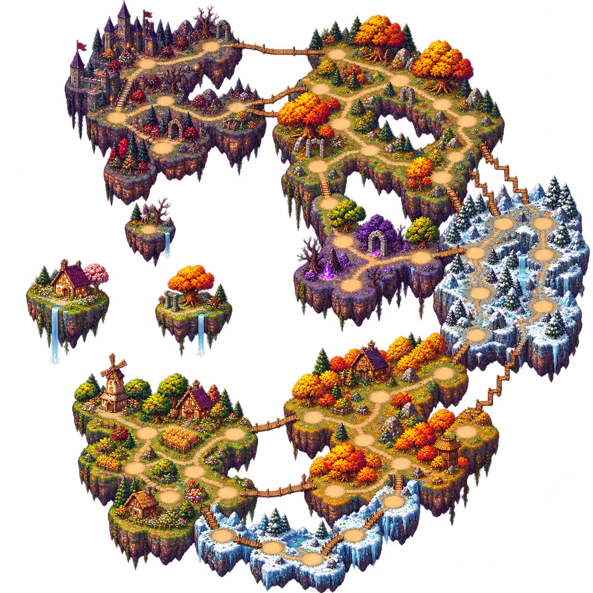

# Quizgame: квизы для компании, летающие острова и подготовка к релизу

Делаю сайт, на котором можно собрать друзей в комнате и проверить, кто лучше помнит игры, аниме, кино и всякие узнаваемые детали из поп-культуры. В основе — короткие раунды, спорные догадки и знакомое «да я же это знаю, как оно называлось».

## Что уже работает

В комнатах можно угадывать игры по скриншотам, музыке, иконкам достижений и интерфейсу. Есть квизы по кадрам из аниме и кино, оружию, предметам, боссам и локациям. Для компании с разными интересами — смешанные подборки. Отдельно появился командный режим по One Piece: команды загадывают персонажей друг другу и ищут ответ по подсказкам.

## Quiz Party

Самый большой эксперимент — настольный режим внутри сайта. Игроки бросают кубик, выбирают путь по островам и отвечают на вопросы. Правильный ответ приносит карточку с эффектом; карточками можно помогать себе и вмешиваться в планы соперников. Цель — добраться до замка и правильно ответить на финальный вопрос.

Перед игрой выбирается персонаж со своими способностями. Например, лич начинает слабее, но усиливается за правильные ответы. Накопленный прогресс не теряется из-за ошибки.

В последнем обновлении переделал окружение в цельный пиксельный архипелаг: поля и деревня постепенно сменяются другими биомами и тёмным замком. Для короткой, средней и длинной партии подготовлены маршруты на 18, 24 и 30 шагов. Ещё добавил перемещение карты зажатой мышью, плавное затухание по краям и стеклянные панели поверх окружения.

## Что дальше

В профиль добавлены смена ника и пароля, а также завершение входов на других устройствах. Восстановление доступа и подтверждение почты подготовлены к подключению отправки писем.

Сейчас готовлю сайт к первому публичному запуску. Следующие этапы — улучшения комнат и переподключения, а затем ежедневные тематические квизы.

Хочу привязывать тему дня к событиям медиакультуры: например, выпускать подборку по значимой франшизе в её памятную дату. Также буду расширять коллекцию оформления — рамки, фишки, карточки и другие способы сделать профиль своим.

Проект пока в разработке. Код остаётся закрытым, а здесь буду показывать прогресс, новые режимы и изменения перед релизом. Ссылкой на открытый тест поделюсь отдельно.

Ещё подготовил приглашения по ссылке: после входа или регистрации игрок возвращается к приглашению в нужную комнату. Выход ведущего передаёт роль следующему участнику. Для подтверждённой почты готовы уведомления о смене ника и пароля; реальную отправку подключу вместе с собственным доменом.
